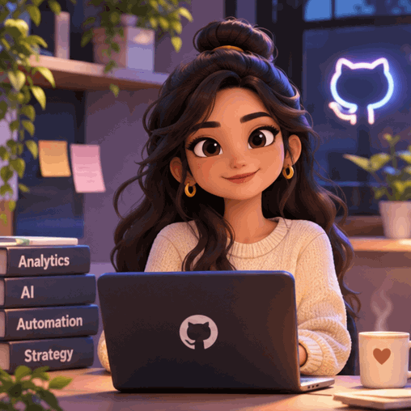

# Hey there, I'm Chaitra! 👋

### Part analyst. Part builder. Always curious.

**Welcome to my little corner of data, ideas, and intelligent things! ✨**

*I started by asking what the numbers mean.*  
*Now I'm equally curious about what we can build with them.*

[🌐 My Portfolio](https://chaitrapulletikurthi.github.io/-chaitranehapulletikurthi.github.io/) &nbsp; • &nbsp; [💼 LinkedIn](https://www.linkedin.com/in/chaitranehapulletikurthi/) &nbsp; • &nbsp; [💻 My Work](https://github.com/chaitrapulletikurthi?tab=repositories)

---

## 🌱 A Little About My Journey

My journey started in financial services, where I spent nearly four years at **Synchrony Financial**, moving from analyzing customer behavior and business performance to leading analytics initiatives that supported strategic decisions.

Somewhere along the way, I realized something.

**I didn't just enjoy finding insights. I wanted to build solutions around them.**

That curiosity led me to pursue a Master's in Business Analytics at the University of North Texas and explore machine learning, conversational AI, and intelligent automation.

Today, I enjoy connecting three worlds:

**Business problems + Data-driven thinking + Technology that makes things happen.**

---

## 🧩 Three Sides of Me

### 📊 The Analyst

I like finding the story hiding inside data.

From customer lifecycle analytics and fraud strategy to KPI frameworks and executive reporting, I've worked on translating complex information into decisions that improve business performance.

### 💡 The Problem Solver

I'm interested in the *why* behind business problems.

Why are customers dropping off? Where are processes slowing down? What can we measure differently? How can we make decisions more intelligently?

For me, good analytics starts with asking better questions.

### 🤖 The Builder

I enjoy experimenting with technology that turns ideas into working solutions.

Recently, I've been building AI-powered voice agents, CRM automations, and machine learning applications that connect business needs with practical implementation.

Not technology for the sake of technology — **technology that solves something meaningful.**

---

## 🔭 Currently Exploring

My curiosity has been taking me into some exciting areas:

- 🎙️ **Conversational AI** — Voice agents that can interact, understand intent, and support real business workflows
- ⚙️ **Intelligent Automation** — Connecting AI, APIs, and operational systems to simplify repetitive processes
- 🧠 **Applied AI & LLMs** — Making unstructured information useful for business decisions
- 📈 **Product & Customer Analytics** — Understanding behavior, measuring outcomes, and improving experiences
- 🚀 **AI-Driven Business Strategy** — Exploring how organizations can adopt AI in practical, scalable ways

*I'm especially interested in the space where analytical thinking meets product thinking and execution.*

---

## 🛠️ My Toolkit

| What I Do | Tools I Work With |
|---|---|
| 📊 Analytics & BI | SQL, Python, SAS, Tableau, Excel, Adobe Analytics |
| 🧠 Machine Learning | Scikit-learn, Pandas, NLP, LLMs |
| 🤖 Conversational AI | Vapi, AI Voice Agents, Prompt Design |
| ⚙️ Automation | n8n, Airtable, REST APIs, Webhooks, Telnyx |
| 📈 Business Strategy | KPI Design, Customer Analytics, Process Optimization |

---

## 🧪 Things I've Built & Explored

A few examples of how I turn curiosity into something tangible:

**🎙️ [NEXUS — AI Voice & Business Automation](https://github.com/chaitrapulletikurthi/nexus-ai-voice-automation)**  
Connecting conversational AI with CRM automation to streamline buyer engagement and sales operations.

**📊 [Customer Complaint Intelligence](https://github.com/chaitrapulletikurthi/CFPB)**  
Combining machine learning and LLMs to classify customer complaints and identify operational risk signals.

**👥 [HR & Talent Analytics](https://github.com/chaitrapulletikurthi/HR-Analytics)**  
Exploring workforce intelligence, talent readiness, and data-driven people decisions.

**🎙️ [Voice Agent Experiments](https://github.com/chaitrapulletikurthi/Voice-Agent-Demo)**  
Experimenting with conversational AI and real-world voice interactions.

Explore the rest of my experiments in my [repositories](https://github.com/chaitrapulletikurthi?tab=repositories).

---

## ✨ What I'm Looking Forward To

I'm excited by opportunities where I can combine **business analytics, strategy, product thinking, and applied AI** to create meaningful impact.

I believe the most interesting solutions don't come from technology alone. They come from understanding the problem, asking the right questions, and having the curiosity to build something better.

And I'm still learning, experimenting, and figuring out what comes next.

That's the fun part. 🌱

---

### 💬 Let's Connect!

Whether it's analytics, an interesting AI idea, or a business problem worth solving, I'm always happy to connect.

[💼 LinkedIn](https://www.linkedin.com/in/chaitranehapulletikurthi/) &nbsp; | &nbsp; [🌐 Portfolio](https://chaitrapulletikurthi.github.io/-chaitranehapulletikurthi.github.io/) &nbsp; | &nbsp; [💻 GitHub](https://github.com/chaitrapulletikurthi)

---

*Thanks for stopping by my little corner of GitHub! ✨*

